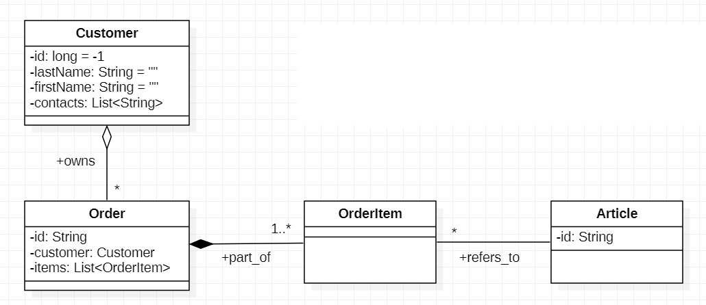
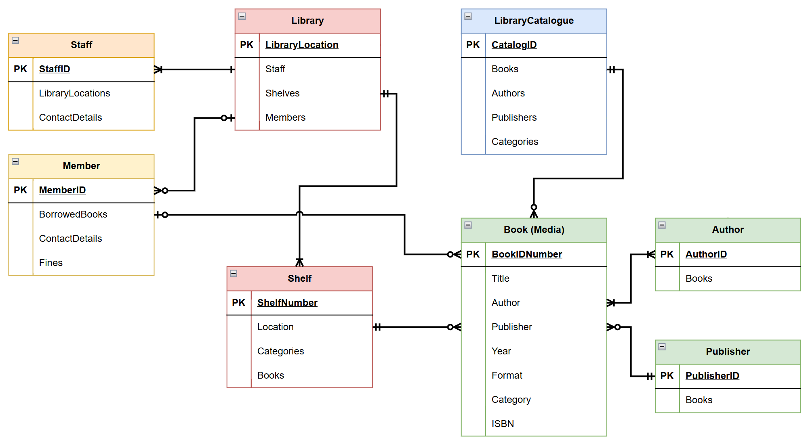

<!-- - - - - - - - - - - - - - - - - - - - - - - - - - - - - - - - - - - - -->
## UML Diagramme

<table style="width: 100%; border-collapse: collapse;">
  <tbody>
    <tr>
      <td style="width: 50%; padding: 8px;" valign="top" colspan="2">
            <!-- UML -->
            
<i>Unified Modelling Language (UML)</i> erlaubt die graphische
                Modellierung von Abläufen und Strukturen in Software Systemen.
                UML besteht aus verschiedenen Diagrammen, die sich in
                <i>Struktur-</i> und <i>Verhaltensdiagramme</i> gliedern.
                <!-- UML-Standard -->
                <i>UML</i> ist ein Standard der
                <a href="https://www.omg.org" target="_blank" rel="noopener"><i>Object Management Group (OMG)</i></a>,
                    aktuell ist Version
                <a href="https://www.omg.org/spec/UML/2.5.1" target="_blank" rel="noopener"><i>UML-2.5.1</i></a>
                    (2017,
                <a href="https://www.omg.org/spec/UML/2.5.1/PDF" target="_blank" rel="noopener"><i>pdf</i></a>,
                    796 Seiten) - siehe auch
                <!-- UML-Einfuehrung -->
                <a href="https://github.com/sgra64/markup/blob/se2-uml/slide-decks/UML-Einfuehrung.pdf"
                    target="_blank"><i>UML-Einführung</i></a>.
            

            

                <i>Struktur-Diagramme</i> beschreiben Strukturen. Sie sind feststehend
                und haben keine Schritte (kein: 1., 2., 3. ... ) und keine Pfeile.
                <i>Verhaltens-Diagramme</i> beschreiben Schrittfolgen, haben stets einen
                Anfang und haben Pfeile.
                Man zeigt niemals beides (Strukturen und Verhalten) im selben Diagramm!
            

      </td>
    </tr>
    <tr>
      <td style="padding: 8px" valign="top">
            <b><i>Struktur-Diagramme</i></b> - zeigen Strukturen
            
feststehend, keine Schritte, keine Pfeile.

      </td>
      <td style="padding: 8px" valign="top">
        <b><i>Verhaltens-Diagramme</i></b> - zeigen Abläufe
        
Schrittfolgen, Pfeile.

      </td>
    </tr>
    <tr>
      <td style="padding: 8px" valign="top">
        <ul>
            <li>
                <!-- UML Komponentendiagramm -->
                Das
                <a href="https://github.com/sgra64/markup/blob/se2-uml/slide-decks/Komponentendiagramm.pdf"
                    target="_blank"><i>UML Komponenten-Diagramm</i></a>
                zeigt die Architektur eines Systems als Komponenten mit Interfaces.
            </li>
        </ul>
      </td>
      <td style="padding: 8px" valign="top">
        <ul>
            <li>
                <!-- UML Use Case-Diagramm -->
                Das
                <a href="https://github.com/sgra64/markup/blob/se2-uml/slide-decks/UseCase-Diagramm.pdf"
                    target="_blank"><i>UML Use Case-Diagramm</i></a>
                zeigt Anwendungsfälle, die Akteure mit dem System haben.
            </li>
        </ul>
      </td>
    </tr>
    <tr>
      <td style="padding: 8px" valign="top">
        <ul>
            <li>
                <!-- UML Klassen-Diagramm -->
                Das
                <a href="https://github.com/sgra64/markup/blob/se2-uml/slide-decks/Klassendiagramm.pdf"
                    target="_blank"><i>UML Klassen-Diagramm</i></a>
                zeigt Klassen mit Attributen und Methoden sowie Beziehungen
                zwischen Klassen mit Vererbung, Komposition, Aggregation sowie
                Kardinalitäten.
                

                    
                

            </li>
            <li style="margin-top: 20px;">
                <!-- Entity Relationship Diagram (ERD) -->
                <a href="https://en.wikipedia.org/wiki/Entity%E2%80%93relationship_model#Cardinalities"
                    target="_blank"><i>Entity Relationship Diagram (ERD)</i></a>
                nach <i>"crow foot notation"</i> ist kein UML-Diagramm, fällt
                aber in die Kategorie der Strukturdiagramme.
                

                    
                

            </li>
        </ul>
      </td>
      <td style="padding: 8px" valign="top">
        <ul>
            <li>
                <!-- UML Aktivitätsdiagramm -->
                Das
                <a href="https://github.com/sgra64/markup/blob/se2-uml/slide-decks/Aktivitaetsdiagramm.pdf"
                    target="_blank"><i>UML Aktivitätsdiagramm</i></a>
                zeigt den Ablauf eines Geschäfts-Prozesses.
            </li>
            <li style="margin-top: 20px;">
                <!-- UML Sequenzdiagramm -->
                Das
                <a href="https://github.com/sgra64/markup/blob/se2-uml/slide-decks/Sequenzdiagramm.pdf"
                    target="_blank"><i>UML Sequenzdiagramm</i></a>
                zeigt Interaktionen mit dem System bzw. Aufrufe zwischen
                Komponenten. Eine gute Einführung ist das Video (3:23min).
            </li>
            <li style="margin-top: 20px;">
                <!-- UML Zustandsdiagramm -->
                Das
                <a href="https://github.com/sgra64/markup/blob/se2-uml/slide-decks/Zustandsdiagramm.pdf"
                    target="_blank"><i>UML Zustandsdiagramm</i></a>
                zeigt das Verhalten eines Systems als Übergänge (Transitionen)
                zwischen Zuständen. Eine gute Einführung ist das
                <i>Video<i>
                (2:23min) von Thomas Grosser.
            </li>
        </ul>
      </td>
    </tr>
  </tbody>
</table>
UML Cheat Sheet - alle Diagramme kompakt: pdf.

&nbsp;
&nbsp;
&nbsp;
&nbsp;
&nbsp;
&nbsp;
&nbsp;
&nbsp;
<!-- 

<a href="https://drive.google.com/file/d/17I-gFyJnwUV39AmjQ9oFHbSy7vy4PVAl/view?usp=sharing"
    target="_blank" rel="noopener"><i>UML-Komponentendiagramm</i></a>

 -->

<!-- 

## B1-B6: *Requirements Analysis* -- *What* does the *User* want?

Audience of *Requirements Analysis* are stakeholders (people), hence *quality*
and (human-consumable) *quantity* of produced material matters.

&nbsp;
---
### *Context / Scenario*

*freerider.de* is a car rental / car sharing company that operates a fleet of
cars mainly in cities without permanent stations. Cars are parked in public
spaces when not used. The system permanently tracks car locations by GPS.
Vehicle can be reserved at particular times and locations.
If a reservation is accepted, the vehicle will be made available at the
requested time and location.

Understand the car rental scenario and complete tasks:

- [*B1: Use Cases, Glossar*](README-B1-Use-Cases-Glossary.md), 4 Pkt.

- [*B2: UML Use Case Diagram*](README-B2-Use-Case-Diagram.md), 4 Pkt.

- [*B3: User Stories*](README-B3-User-Stories.md), 3 Pkt.

- [*B4: Functional and Non-functional Rquirements*](README-B4-FA-NFA.md), 3 Pkt.

- [*B5: Business Process: New Customer Registration (individual)*](README-B5-BP-Registration.md), 5 Pkt.

- [*B6: Business Process: Car Reservation*](README-B6-BP-Reservation.md), 5 Pkt.
 -->
